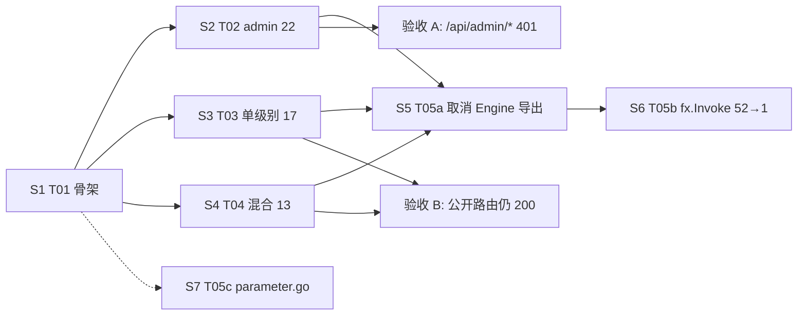

# GeekAI 重构任务分解（Phase 1 可派工 / Phase 2-3 提要）

> 基线：commit `f32d2023`，tag `pre-vue-merge` → `568ff5cb`。工作区干净，`go build ./...` / `go vet ./...` / `go test ./...` 全绿。
> 本轮范围：**只改"路由注册方式"和"参数中间件实现"**，不碰任何业务 handler 内部逻辑。
> 所有结论均逐文件核对过源码，未凭命名推断。凡未实证的地方单列「推断」。

---

## 0. 一句话结论

漏挂鉴权的根因不是"7 个文件忘了写一行 `Use()`"，而是 **`*gin.Engine` 被当成字段传给了每一个 handler**：任何人任何时刻都能 `h.App.Engine.Group("/api/admin/...")` 拿到一个**没有任何中间件**的路由组；而 `gin` 的 `Use()` 只对**调用之后**注册的路由生效——于是"公开路由 + 受保护路由共用一个 group、中间插一行 `Use()`"这种写法，天然只能靠作者记忆保证正确。

修法不是"再补 7 行 `Use()`"，而是**让 handler 拿不到 `*gin.Engine`**：引擎字段取消导出，改注入 `core.Router`，它的四个取值在**构造时**就固定了安全级别，之后不可提升也不可下降。补 7 行 `Use()` 只是这次修复的**结果**，不是**机制**。

---

# Part A：Phase 1 设计方案

## 1. 收敛机制：`core.Router`

### 1.1 核心类型

新建 `D:\studio\geekai\api\core\router.go`：

```go
package core

// Router 是全局唯一的路由注册入口。
//
// 设计约束（刻意的，写在这里以免后来者"顺手优化"回去）：
//  1. Router 不持有、不暴露 *gin.Engine。handler 层物理上无法拿到引擎。
//  2. 四个 group 在 NewRouter 里一次性建成，安全级别此后不可变；
//     Router 不提供任何 Use() 之类"事后追加中间件"的方法。
//  3. 唯一允许出现 /api/admin 前缀的是 AdminGroup 与 AdminPublicGroup；
//     PublicGroup / UserGroup 传入 /api/admin 前缀在启动期直接 panic。
type Router struct {
	pub      *gin.RouterGroup // 无鉴权，挂在 "/"
	user     *gin.RouterGroup // 已挂 UserAuthMiddleware，挂在 "/"
	admin    *gin.RouterGroup // 已挂 AdminAuthMiddleware，挂在 "/api/admin"
	adminPub *gin.RouterGroup // 无鉴权，挂在 "/api/admin"，只服务于 login / logout
}

// NewRouter 纯函数构造：不改 gin 全局模式、不注册任何业务路由。
func NewRouter(engine *gin.Engine, cfg *types.AppConfig, redis *redis.Client) *Router {
	return &Router{
		pub:      engine.Group("/"),
		user:     engine.Group("/", middleware.UserAuthMiddleware(cfg.Session.SecretKey, redis)),
		admin:    engine.Group("/api/admin", middleware.AdminAuthMiddleware(cfg.AdminSession.SecretKey, redis)),
		adminPub: engine.Group("/api/admin"),
	}
}

// PublicGroup 公开路由。额外中间件在"建组时"一次传入，不存在事后补挂。
func (r *Router) PublicGroup(prefix string, handlers ...gin.HandlerFunc) *gin.RouterGroup {
	if isAdminPrefix(prefix) {
		panic("core.Router: /api/admin 前缀必须使用 AdminGroup 或 AdminPublicGroup，PublicGroup 收到: " + prefix)
	}
	return r.pub.Group(prefix, handlers...)
}

func (r *Router) UserGroup(prefix string, handlers ...gin.HandlerFunc) *gin.RouterGroup {
	return r.user.Group(prefix, handlers...)
}

func (r *Router) AdminGroup(prefix string, handlers ...gin.HandlerFunc) *gin.RouterGroup {
	return r.admin.Group(prefix, handlers...)
}

// AdminPublicGroup 是 /api/admin 下唯一的安全出口：不带参数、只此一个实例。
func (r *Router) AdminPublicGroup() *gin.RouterGroup { return r.adminPub }

// StaticFiles 静态目录（当前只有 /update），走公开链，继承全局中间件。
func (r *Router) StaticFiles(prefix, dir string, handlers ...gin.HandlerFunc) {
	r.pub.Group("", handlers...).Static(prefix, dir)
}

// RouteRegistrar 所有 handler 的注册契约。
type RouteRegistrar interface {
	RegisterRoutes(r *Router)
}

func isAdminPrefix(p string) bool {
	return p == "/api/admin" || strings.HasPrefix(p, "/api/admin/")
}
```

### 1.2 如何用类型消灭「`Use()` 只对之后注册的路由生效」这个语义（不是靠 review）

`gin` 的真实语义：

- `Group()` **复制**父组的 handler 链 → 子组默认继承父组全部中间件；
- `Use()` **追加**到本组链上，只影响**之后再注册**的路由。

今天的 bug 形态是「**一个 group 同时承载两种安全级别**」：先注册公开路由 → `Use(auth)` → 再注册受保护路由。这个形态之所以写得出来，是因为 `Group()` 返回的是一个**开放的、安全级别可变**的对象。

本方案把它拆成两件不可再组合的事：

| 旧写法 | 新写法 | 为什么不会再错 |
|---|---|---|
| `g := h.App.Engine.Group("/api/x/")`<br>`g.GET("pub", …)`<br>`g.Use(auth)`<br>`g.GET("priv", …)` | `r.PublicGroup("/api/x/").GET("pub", …)`<br>`r.UserGroup("/api/x/").GET("priv", …)` | 安全级别由**方法名**决定，并在 `NewRouter` 里已烧进 handler 链。两次调用拿到的是**两个不同对象**，"忘了 Use"这个动作**没有地方可以发生**。 |

三层保障，从强到弱：

1. **编译期（最强，真"消灭"）**：`AppServer.Engine` 取消导出为 `engine`。handler 包里的持有点只剩 `*core.Router`，写 `h.App.engine` 直接编译不过。
2. **启动期 panic（强，可测）**：`PublicGroup` / `UserGroup` 收到 `/api/admin` 前缀 → `panic`。"任何管理后台接口只可能落在带 `AdminAuthMiddleware` 的链上"成为一条运行期断言，且由 `core/router_test.go` 覆盖。
3. **grep 门禁（弱，兜底）**：`grep -rn "\.Use(" api/handler` 期望 **0**。

> 诚实说明：第 3 层不是可有可无的装饰。`PublicGroup` 返回的仍是 `*gin.RouterGroup`，理论上仍可对它 `.Use()`。要做到 100% 类型封闭，需要包一个 `core.Group` 包装类型（约 20 个转发方法），收益不抵成本，**故不采用**，改用一条可执行 CI grep 兜底。这是一个明示的、可度量的残余风险，不是遗漏。

### 1.3 三类（实为四类）路由组的划分规则

判定规则，按优先级自上而下，**第一条命中即定**：

| # | 规则 | 归属 |
|---|---|---|
| R1 | 由第三方服务器发起、无用户 token 的回调（支付网关、微信服务器） | `PublicGroup` |
| R2 | 登录/注册/找回密码/验证码/短信验证码等**取得身份之前**必须能调的接口 | `PublicGroup` |
| R3 | 前台展厅/价格/导航/配置等**匿名首页首屏**就要拿的数据 | `PublicGroup` |
| R4 | 桌面客户端自动更新（无 token、发生在登录之前） | `PublicGroup` / `StaticFiles` |
| R5 | 自带鉴权体系的对外 API（`/v1/*` 用 Model Token） | `PublicGroup(prefix, h.authenticate)` |
| R6 | 路径以 `/api/admin` 开头，且不是 admin 的 login/logout | `AdminGroup` |
| R7 | 路径以 `/api/admin` 开头，是 login / logout | `AdminPublicGroup` |
| R8 | 其余全部 | `UserGroup` |

**R8 是默认档**：不是"要鉴权才放进 User"，而是"没有明确公开理由的一律进 User"。这样"新增接口忘了想鉴权"的默认结果是**被保护**，而不是**裸奔**——默认值的方向反过来了。

### 1.4 `AppServer` 的改造

> 下面是 **S5 完成后的目标形态**。S1–S4 期间字段仍叫 `Engine`（导出），只是新增 `Router`，以便每一步都能编译；`Engine → engine` 的改名由 S5 一步机械完成，不要在 S1 就改。

`D:\studio\geekai\api\core\app_server.go`：

```go
type AppServer struct {
	Config    *types.AppConfig
	SysConfig *types.SystemConfig
	Redis     *redis.Client
	Router    *Router   // 新增：对外唯一路由入口

	engine    *gin.Engine // ← 由 Engine 改成 engine：不再导出
}

func NewServer(appConfig *types.AppConfig, redis *redis.Client, sysConfig *types.SystemConfig) *AppServer {
	gin.SetMode(gin.ReleaseMode)
	gin.DefaultWriter = io.Discard
	s := &AppServer{Config: appConfig, Redis: redis, SysConfig: sysConfig, engine: gin.Default()}
	s.initEngine()
	return s
}

// NewServerWithEngine 仅供测试注入自定义 *gin.Engine。
// 刻意不调用 gin.SetMode，保持调用方设置的 TestMode。
func NewServerWithEngine(engine *gin.Engine, appConfig *types.AppConfig, redis *redis.Client) *AppServer {
	s := &AppServer{Config: appConfig, Redis: redis, engine: engine}
	s.initEngine()
	return s
}

func (s *AppServer) initEngine() {
	s.engine.Use(middleware.ThumbMiddleware())
	s.engine.Use(middleware.ParameterHandlerMiddleware())
	s.engine.Use(errorHandler)
	if s.Config.StaticDir != "" { // 唯一的行为微调：空 StaticDir 不再注册一个指向 cwd 的静态路由
		s.engine.Static("/static", s.Config.StaticDir)
	}
	s.Router = NewRouter(s.engine, s.Config, s.Redis)
}
```

**`Init(client *redis.Client)` 整个删除**。理由（已核对）：

- 函数体从未使用 `client` 参数（`app_server.go:46-52`）；
- `*redis.Client` 已经是 `NewServer` 的入参；
- 删除后顺带消掉 "Router 必须在 Init 之后才能构造" 的**顺序依赖**——现在是"构造即完备"，不存在 nil Router 的窗口；
- `main.go` 因此少一个 `fx.Invoke`（61 → 60，最终 → 10）。

### 1.5 `h.App.Engine` 的剩余用途如何处置

全仓 `h.App.Engine` 的非测试引用共 **55** 处（52 个 handler，其中 `download_handler.go`/`net_handler.go`/`model_api_handler.go` 各 2 处）。改造后去向：

| 原用途 | 处置 | 位置 |
|---|---|---|
| `gin.Default()` 建引擎 | 保留，但字段不导出 | `core/app_server.go` |
| `s.Engine.Use(Thumb / Parameter / errorHandler)` | 保留在 `initEngine()`，只有 3 行，且 `NewRouter` 的四个子组全部继承 | `core/app_server.go` |
| `s.Engine.Static("/static", StaticDir)` | 保留在 `initEngine()`（必须继承 `ThumbMiddleware`，`thumb.go:19` 判断 `HasPrefix(url, "/static/")`） | `core/app_server.go` |
| 52 处 `Group(...)` | 改为 `r.<Level>Group(...)` | 52 个 handler |
| `download_handler.go` 的 `/update` Static | 改为 `r.StaticFiles("/update", h.updateDir, withDownloadWriteDeadline(), withUpdateCacheControl())` | `handler/download_handler.go` |
| `net_handler.go` 的 `GET /api/download` | 改为 `r.PublicGroup("").GET("/api/download", h.Download)` | `handler/net_handler.go` |
| `model_api_handler.go` 的 `/v1` 组 | 改为 `r.PublicGroup("/v1", h.authenticate)` | `handler/model_api_handler.go` |
| 3 个测试文件里的 `&core.AppServer{Engine: …}` | 改为 `core.NewServerWithEngine(...)` + 各自的 `*gin.Engine` 变量 | 见 §2 |

**"不重新打开漏挂的口子"的三条硬约束**（写进 `router.go` 头注释）：

1. 不给 `*gin.Engine` 提供任何 getter（`Engine()` / `Gin()` / `GetEngine()` 一律不加）。测试需要引擎时用 `NewServerWithEngine` 拿**自己传进去的那个变量**，而不是从 `AppServer` 里取。
2. `StaticFiles` 是**唯一**的静态出口，它挂在 `pub` 组下 —— 静态目录不需要鉴权，但也不会因此获得注册 API 路由的能力（`Static` 只注册一条 `GET /*filepath`）。
3. `isAdminPrefix` panic 是**白名单式**的：将来真要加一个公开的 admin 接口，必须改 `core` 包里的这个函数，改动会出现在 `core` 的 diff 里被 reviewer 看见，而不是散落在 22 个 handler 的某一行。

---

## 2. 文件清单（逐文件，52 个 handler 全列）

> 路径均为绝对路径。`等级` 列即改造后使用的 `Router` 方法。`拆` = 该文件同时包含公开与受保护路由，需要拆成两个 group（**前缀保持不变**，只是分别归属不同安全级别）。
> 机械变换规则（对每个 handler 逐字适用，路径零变化）：
> `group := h.App.Engine.Group(P)` → `group := r.<等级>Group(P)`，并删除紧随的 `group.Use(middleware.XxxAuthMiddleware(...))`。

### 2.1 core / main（T01）

| 文件 | 改什么 |
|---|---|
| `D:\studio\geekai\api\core\router.go` | **新建**。`Router` / `NewRouter` / 4 个 group 方法 / `StaticFiles` / `RouteRegistrar` / `isAdminPrefix` panic 断言（见 §1.1） |
| `D:\studio\geekai\api\core\app_server.go` | **S1**：新增 `Router` 字段 + `NewServerWithEngine`，删除 `Init`（逻辑并入 `initEngine()`，末尾 `s.Router = NewRouter(s.Engine, …)`）；**S5**：`Engine` → `engine` 取消导出，`Run`/`initEngine` 同步改引用 |
| `D:\studio\geekai\api\core\middleware\parameter.go` | JSON body 解析改用 `json.Decoder` + `UseNumber()`；解析失败还原**原始字节**；回写后同步 `ContentLength`；数字规范化（见 §8） |
| `D:\studio\geekai\api\main.go` | 删除 `fx.Invoke(func(s, client){ s.Init(client) })`；新增 `fx.Provide(func(s *core.AppServer) *core.Router { return s.Router })` |

### 2.2 管理后台 22 个 handler（T02）

| # | 文件 | 原前缀 | 改后等级 | 备注 |
|---|---|---|---|---|
| 1 | `api\handler\admin\admin_handler.go` | `/api/admin/` | **拆** `AdminPublicGroup()` + `AdminGroup("/api/admin/")` | `login`/`logout` 走 `AdminPublicGroup().POST("/login")` / `.GET("/logout")`（路径不变，仍为 `/api/admin/login`、`/api/admin/logout`）；`session`/`list`/`save`/`enable`/`remove`/`resetPass` 走 `AdminGroup` |
| 2 | `api\handler\admin\api_key_handler.go` | `/api/admin/apikey/` | `AdminGroup` | 删 `Use` |
| 3 | `api\handler\admin\chat_app_handler.go` | `/api/admin/role/` | `AdminGroup` | 删 `Use` |
| 4 | `api\handler\admin\chat_app_type_handler.go` | `/api/admin/app/type/` | `AdminGroup` | 删 `Use` |
| 5 | `api\handler\admin\chat_handler.go` | `/api/admin/chat/` | `AdminGroup` | 删 `Use` |
| 6 | `api\handler\admin\chat_model_handler.go` | `/api/admin/model/` | `AdminGroup` | 删 `Use` |
| 7 | `api\handler\admin\config_handler.go` | `/api/admin/config` | `AdminGroup` | 删 `Use` |
| 8 | `api\handler\admin\dashboard_handler.go` | `/api/admin/dashboard/` | `AdminGroup` | **漏挂修复** |
| 9 | `api\handler\admin\function_handler.go` | `/api/admin/function/` | `AdminGroup` | 删 `Use` |
| 10 | `api\handler\admin\image_handler.go` | `/api/admin/image/` | `AdminGroup` | 删 `Use` |
| 11 | `api\handler\admin\jimeng_handler.go` | `/api/admin/jimeng/` | `AdminGroup` | **漏挂修复** |
| 12 | `api\handler\admin\library_handler.go` | `/api/admin/library` | `AdminGroup` | `RegisterRoutes(r)` 内改为 `h.RegisterManagementRoutes(r.AdminGroup("/api/admin/library"))`；同步删除 `middleware` 与 `h.app` 字段的注册用途（`RegisterManagementRoutes(group *gin.RouterGroup)` 签名**保持不变**，集成测试在用它） |
| 13 | `api\handler\admin\menu_handler.go` | `/api/admin/menu/` | `AdminGroup` | **漏挂修复** |
| 14 | `api\handler\admin\moderation_handler.go` | `/api/admin/moderation/` | `AdminGroup` | 删 `Use` |
| 15 | `api\handler\admin\order_handler.go` | `/api/admin/order/` | `AdminGroup` | **漏挂修复**（含破坏性 `GET clear`） |
| 16 | `api\handler\admin\power_log_handler.go` | `/api/admin/powerLog/` | `AdminGroup` | **漏挂修复** |
| 17 | `api\handler\admin\product_handler.go` | `/api/admin/product/` | `AdminGroup` | **漏挂修复** |
| 18 | `api\handler\admin\redeem_handler.go` | `/api/admin/redeem/` | `AdminGroup` | **漏挂修复**（造钱入口） |
| 19 | `api\handler\admin\suno_handler.go` | `/api/admin/suno/` | `AdminGroup` | 删 `Use` |
| 20 | `api\handler\admin\upload_handler.go` | `/api/admin/upload` | `AdminGroup` | 删 `Use` |
| 21 | `api\handler\admin\user_handler.go` | `/api/admin/user/` | `AdminGroup` | 删 `Use` |
| 22 | `api\handler\admin\video_handler.go` | `/api/admin/video/` | `AdminGroup` | 删 `Use` |
| — | `api\main.go` | — | — | 22 个 `fx.Invoke` 的闭包参数由 `(s *core.AppServer, h *admin.X)` 改为 `(r *core.Router, h *admin.X)`，调用改为 `h.RegisterRoutes(r)` |

### 2.3 单级别业务 handler 17 个（T03）

| # | 文件 | 原前缀 | 改后等级 |
|---|---|---|---|
| 1 | `api\handler\captcha_handler.go` | `/api/captcha/` | `PublicGroup` |
| 2 | `api\handler\chat_app_type_handler.go` | `/api/app/type/` | `PublicGroup` |
| 3 | `api\handler\chat_model_handler.go` | `/api/model/` | `PublicGroup` |
| 4 | `api\handler\config_handler.go` | `/api/config/` | `PublicGroup` |
| 5 | `api\handler\function_handler.go` | `/api/function/` | `PublicGroup`（**5 条全部保持公开**，内部 `checkAuth` 保留，见 §2.7） |
| 6 | `api\handler\library_handler.go` | `/api/v1` | `PublicGroup("/api/v1").GET("/library", h.catalog)` |
| 7 | `api\handler\menu_handler.go` | `/api/menu/` | `PublicGroup` |
| 8 | `api\handler\product_handler.go` | `/api/product/` | `PublicGroup` |
| 9 | `api\handler\sms_handler.go` | `/api/sms/` | `PublicGroup` |
| 10 | `api\handler\wxgzh_handler.go` | `/api/wx/` | `PublicGroup` |
| 11 | `api\handler\markmap_handler.go` | `/api/markMap/` | `UserGroup`（删 `Use`） |
| 12 | `api\handler\order_handler.go` | `/api/order/` | `UserGroup`（删 `Use`） |
| 13 | `api\handler\power_log_handler.go` | `/api/powerLog/` | `UserGroup`（删 `Use`） |
| 14 | `api\handler\realtime_handler.go` | `/api/realtime/` | `UserGroup`（删 `Use`；前缀保留尾斜杠，`Any("")` 命中 `/api/realtime/`） |
| 15 | `api\handler\redeem_handler.go` | `/api/redeem/` | `UserGroup`（删 `Use`） |
| 16 | `api\handler\test_handler.go` | `/api/test/` | `UserGroup`（删 `Use`） |
| 17 | `api\handler\video_handler.go` | `/api/video/` | `UserGroup`（删 `Use`） |
| — | `api\main.go` | — | 17 个 `fx.Invoke` 同步改签名 |

### 2.4 混合 handler 13 个（T04）—— 需要拆成两个 group

| # | 文件 | 公开部分（原注册在 `Use` 之前） | 受保护部分 |
|---|---|---|---|
| 1 | `api\handler\chat_app_handler.go` | `/api/app/list` | `/api/app/list/user`、`create`、`copy`、`update`、`remove` → `UserGroup("/api/app/")` |
| 2 | `api\handler\chat_handler.go` | `/api/chat/detail`、`/api/chat/history` | `message`、`list`、`update`、`remove`、`clear`、`tokens`、`stop`、`tts` → `UserGroup("/api/chat/")` |
| 3 | `api\handler\download_handler.go` | `/api/v1/latest`、`/api/v1/download` → `PublicGroup("/api/v1")` | `/update` 静态 → `r.StaticFiles("/update", h.updateDir, withDownloadWriteDeadline(), withUpdateCacheControl())` |
| 4 | `api\handler\image_handler.go` | `/api/image/imgWall`、`/api/image/models` | `image`、`jobs`、`remove`、`publish` → `UserGroup("/api/image/")` |
| 5 | `api\handler\invite_handler.go` | `/api/invite/hits` | `code`、`list`、`stats`、`rules` → `UserGroup("/api/invite/")` |
| 6 | `api\handler\jimeng_handler.go` | `/api/jimeng/power-config` | `task`、`jobs`、`remove`、`retry` → `UserGroup("/api/jimeng/")` |
| 7 | `api\handler\mj_handler.go` | `/api/mj/imgWall` | `image`、`upscale`、`variation`、`modal`、`jobs`、`remove`、`publish` → `UserGroup("/api/mj/")` |
| 8 | `api\handler\model_api_handler.go` | `/v1/models`、`/v1/chat/completions` → `PublicGroup("/v1", h.authenticate)` | `/api/user/model-token` GET/POST/DELETE → `UserGroup("/api/user/model-token")` |
| 9 | `api\handler\net_handler.go` | `GET /api/download` → `r.PublicGroup("").GET("/api/download", h.Download)` | `/api/upload`、`/api/upload/list`、`/api/upload/remove` → `UserGroup("/api/upload")` |
| 10 | `api\handler\payment_handler.go` | `/api/payment/notify/alipay`、`notify/epay`、`notify/wxpay`、`notify/stripe` | `/api/payment/create` → `UserGroup("/api/payment/")` |
| 11 | `api\handler\prompt_handler.go` | —（原本就全部受保护） | `UserGroup("/api/prompt/")`；限流改为**逐路由**传入：`g.POST("lyric", middleware.RateLimitEvery(h.App.Redis, 30*time.Second), h.Lyric)`，其余 3 条同理。这是唯一需要"每路由不同中间件"的文件 |
| 12 | `api\handler\suno_handler.go` | `/api/suno/play` | `create`、`list`、`remove`、`publish`、`update`、`detail` → `UserGroup("/api/suno/")` |
| 13 | `api\handler\user_handler.go` | 13 条：`register`、`login`、`login/mobile`、`login/tokengine/config`、`login/tokengine/start`、`login/tokengine/callback`、`login/tokengine/complete`、`resetPass`、`login/qrcode`、`login/callback`、`login/status`、`logout`、`wxAuthLogin` → `PublicGroup("/api/user/")` | 7 条：`session`、`profile`、`profile/update`、`password`、`bind/mobile`、`bind/email`、`signin` → `UserGroup("/api/user/")` |
| — | `api\main.go` | — | 13 个 `fx.Invoke` 同步改签名 |

### 2.5 测试文件（T05，随 `Engine` 取消导出一起改）

| 文件 | 改什么 |
|---|---|
| `D:\studio\geekai\api\handler\model_api_handler_test.go` | `modelAPITestHandler` 返回 `(*ModelAPIHandler, *gin.Engine, sqlmock.Sqlmock)`；`app := core.NewServerWithEngine(engine, &types.AppConfig{}, nil)`；`h.RegisterRoutes(app.Router)`；`modelAPIRequest(engine, …)` 用局部 `engine` 变量；`h.App.Engine.Group("/test-token", …)` → `engine.Group("/test-token", …)` |
| `D:\studio\geekai\api\handler\model_api_chat_test.go` | 同上：`h.App.Engine` → 局部 `engine`；`httptest.NewServer(h.App.Engine)` → `httptest.NewServer(engine)` |
| `D:\studio\geekai\api\handler\library_handler_test.go` | `&core.AppServer{Engine: engine, Config: …}` → `core.NewServerWithEngine(engine, &types.AppConfig{}, nil)`；`RegisterRoutes()` → `RegisterRoutes(app.Router)`（2 处） |
| `D:\studio\geekai\api\handler\library_integration_test.go` | `&core.AppServer{Engine: engine}` → `core.NewServerWithEngine(engine, &types.AppConfig{}, nil)`；`RegisterRoutes()` → `RegisterRoutes(app.Router)`；`RegisterManagementRoutes(group)` 保持不动 |
| `D:\studio\geekai\api\core\router_test.go` | **新建**。见 §5 的 4 条断言（不需要 DB / Redis） |

### 2.6 `main.go` 的 61 个 `fx.Invoke` 怎么改

现状（已核实）：**61 个 `fx.Invoke`**，其中 **52 个是路由注册**，9 个是服务启动/生命周期（`Init`、Migration、image、mj、suno、video、jimeng、`Run`、lifecycle）。

改动分两步：

**第一步（T01–T04 期间，保持 1 对 1，只是换签名）**

```go
// 旧
fx.Invoke(func(s *core.AppServer, h *handler.UserHandler) { h.RegisterRoutes() }),
// 新
fx.Invoke(func(r *core.Router, h *handler.UserHandler) { h.RegisterRoutes(r) }),
```

**第二步（T05，52 → 1）**

`fx.As` 方案**不采用**，理由已核实（`go.uber.org/fx@v1.19.3/annotated.go:1146-1159`）：`As` 会**替换**构造函数的返回类型，`*handler.PaymentHandler` 这类"既要注册路由、又要单独 `fx.Invoke` 启动"的具体类型会失踪；且 `fx` 的 group 不保证顺序，gin 路由注册顺序将变成不确定的。

采用 **`fx.In` 结构体 + 显式切片**，DI 语义不变、顺序确定、注册表一目了然：

```go
// api/main.go
type Handlers struct {
	fx.In
	// 用户侧
	ChatApp      *handler.ChatAppHandler
	User         *handler.UserHandler
	Chat         *handler.ChatHandler
	Net          *handler.NetHandler
	Download     *handler.DownloadHandler
	Sms          *handler.SmsHandler
	Redeem       *handler.RedeemHandler
	Captcha      *handler.CaptchaHandler
	Mj           *handler.MidJourneyHandler
	ChatModel    *handler.ChatModelHandler
	ModelAPI     *handler.ModelAPIHandler
	Payment      *handler.PaymentHandler
	Order        *handler.OrderHandler
	Product      *handler.ProductHandler
	Config       *handler.ConfigHandler
	PowerLog     *handler.PowerLogHandler
	Jimeng       *handler.JimengHandler
	WxGzh        *handler.WxGzhHandler
	Invite       *handler.InviteHandler
	Function     *handler.FunctionHandler
	Menu         *handler.MenuHandler
	MarkMap      *handler.MarkMapHandler
	ImageJob     *handler.ImageJobHandler
	Suno         *handler.SunoHandler
	Video        *handler.VideoHandler
	ChatAppType  *handler.ChatAppTypeHandler
	Test         *handler.TestHandler
	Prompt       *handler.PromptHandler
	Realtime     *handler.RealtimeHandler
	Library      *handler.LibraryHandler
	// 管理后台
	AdminConfig       *admin.ConfigHandler
	AdminManager      *admin.ManagerHandler
	AdminApiKey       *admin.ApiKeyHandler
	AdminUser         *admin.UserHandler
	AdminChatApp      *admin.ChatAppHandler
	AdminRedeem       *admin.RedeemHandler
	AdminDashboard    *admin.DashboardHandler
	AdminChatModel    *admin.ChatModelHandler
	AdminProduct      *admin.ProductHandler
	AdminOrder        *admin.OrderHandler
	AdminPowerLog     *admin.PowerLogHandler
	AdminJimeng       *admin.AdminJimengHandler
	AdminVideo        *admin.VideoHandler
	AdminSuno         *admin.SunoHandler
	AdminChatAppType  *admin.ChatAppTypeHandler
	AdminFunction     *admin.FunctionHandler
	AdminUpload       *admin.UploadHandler
	AdminChat         *admin.ChatHandler
	AdminMenu         *admin.MenuHandler
	AdminImage        *admin.ImageHandler
	AdminModeration   *admin.ModerationHandler
	AdminLibrary      *admin.LibraryHandler
}

// registerRoutes 是 main.go 里唯一的路由注册点。
// 新增 handler 必须同时在 Handlers 结构体里加字段、在下面的切片里加一项；
// 数量断言保证"加了字段忘了加切片"在启动期就炸，而不是静默不生效。
func registerRoutes(r *core.Router, hs Handlers) {
	registrars := []core.RouteRegistrar{
		hs.User, hs.ChatApp, hs.Chat, hs.Net, hs.Download, hs.Sms, hs.Redeem,
		hs.Captcha, hs.Mj, hs.ChatModel, hs.ModelAPI, hs.Payment, hs.Order,
		hs.Product, hs.Config, hs.PowerLog, hs.Jimeng, hs.WxGzh, hs.Invite,
		hs.Function, hs.Menu, hs.MarkMap, hs.ImageJob, hs.Suno, hs.Video,
		hs.ChatAppType, hs.Test, hs.Prompt, hs.Realtime, hs.Library,
		hs.AdminConfig, hs.AdminManager, hs.AdminApiKey, hs.AdminUser,
		hs.AdminChatApp, hs.AdminRedeem, hs.AdminDashboard, hs.AdminChatModel,
		hs.AdminProduct, hs.AdminOrder, hs.AdminPowerLog, hs.AdminJimeng,
		hs.AdminVideo, hs.AdminSuno, hs.AdminChatAppType, hs.AdminFunction,
		hs.AdminUpload, hs.AdminChat, hs.AdminMenu, hs.AdminImage,
		hs.AdminModeration, hs.AdminLibrary,
	}
	const wantRegistrars = 52
	if len(registrars) != wantRegistrars {
		logger.Fatalf("路由注册器数量 %d != %d，有 handler 忘记加进 registerRoutes 切片", len(registrars), wantRegistrars)
	}
	for _, reg := range registrars {
		reg.RegisterRoutes(r)
	}
}
```

`fx.Provide(...)` 部分**完全不动**（52 个 handler 仍按原样 provide，具体类型全部保留）。`fx.Invoke` 由 61 → **10**：`registerRoutes` + Migration + image + mj + suno + video + jimeng + `Run` + lifecycle + `PaymentHandler.StartSyncOrders`。

### 2.7 三个"半公开"文件的特殊说明

1. **`api\handler\function_handler.go`**：`list` / `weibo` / `zaobao` / `image3` 共 4 条路由注册在 `.Use()` **之外**，也就是说今天这 4 条**全部是公开的**，鉴权由 handler 内部的 `checkAuth`（`function_handler.go:84`）完成——这是全仓第 3 份鉴权实现。Phase 1 **原样保持公开**（把它收进 `UserGroup` 会额外引入"redis 会话必须存在"这一层校验，属于行为变更），`checkAuth` 保留不动。**收编到 Phase 3**，届时删掉 `checkAuth` 并把 3 条 POST 移入 `UserGroup`。
2. **`api\handler\payment_handler.go`**：4 条 `notify/*` 是第三方服务器回调。它们**必须**留在公开组——误收进 `UserGroup` 的直接后果是"用户付了钱、网关回调被 401、积分永不到账"。
3. **`api\handler\net_handler.go`**：`GET /api/download?url=` 是已知的匿名 SSRF 入口（`net_handler.go:156-186`，无 scheme/host 校验、无 Timeout、原样 `io.Copy` 回吐）。Phase 1 **只做路由平移，保持公开**，因为收紧它是行为变更 + 需要产品决策（是否完全取消该入口）。它被单列在 §6 风险表里。

---

## 3. 依赖顺序（每步之后 `go build ./...` 必须通过）

### 3.1 派工任务（5 个）

| 任务 | 名称 | 文件数 | 依赖 | 优先级 |
|---|---|---|---|---|
| **T01** | 路由骨架 `core.Router` + `AppServer` 改造 + 参数中间件修正 | 4（1 新建） | — | P0 |
| **T02** | 管理后台 22 个 handler 收敛（含 7 个漏挂修复） | 23（22 handler + main.go） | T01 | P0 |
| **T03** | 17 个单级别业务 handler 收敛 | 18（17 handler + main.go） | T01 | P0 |
| **T04** | 13 个混合 handler 拆分（公开 / 受保护分离） | 14（13 handler + main.go） | T01 | P0 |
| **T05** | 收口与门禁：`Engine` 取消导出 + 3 个测试改造 + `fx.Invoke` 52→1 + `router_test.go` | 5（另 1 新建） | T01,T02,T03,T04 | P0 |

T02 / T03 / T04 之间**无依赖**，改动文件集合**互不重叠**，唯一共享文件是 `main.go` 的 `fx.Invoke` 列表（不同行区间，可并行编辑或在 T02 里一次把 52 处签名全改完，T03/T04 就只碰 handler 文件）。这是本次切分的核心收益。

### 3.2 可编译的最小步骤

| 步骤 | 内容 | 完成后可编译的原因 |
|---|---|---|
| **S1**（T01） | 新建 `core/router.go`；`AppServer` 增加 `Router` 字段、`NewServerWithEngine`，把原 `Init` 的逻辑搬进 `initEngine()` 并在末尾 `s.Router = NewRouter(s.Engine, s.Config, s.Redis)`；删除 `Init` 与对应 `fx.Invoke`；`main.go` 加 `fx.Provide(func(s *core.AppServer) *core.Router { return s.Router })` | 52 个 handler 仍用 `h.App.Engine`，`Engine` **本步不改名**，未被触碰 → 编译通过。**不要**在本步引入 `engine` 字段，避免出现"两个字段指向同一对象"的过渡脏状态 |
| **S2**（T02） | 22 个 admin handler 改签名 + 删 15 处 `.Use()` + 7 个漏挂组归位；`main.go` 同步 22 个 invoke | 只剩 30 个业务 handler 用旧字段 |
| **S3**（T03） | 17 个单级别 handler 改签名；`main.go` 同步 17 个 invoke | 只剩 13 个混合 handler 用旧字段 |
| **S4**（T04） | 13 个混合 handler 拆组；`main.go` 同步 13 个 invoke | 此时 `grep "h.App.Engine" handler` 已为 0 |
| **S5**（T05a） | 把 `AppServer.Engine` **改名为取消导出的 `engine`**（`initEngine`/`Run`/`NewRouter` 三处引用）；改 3 个测试文件 + 新建 `core/router_test.go` | 生产代码已不再引用 `Engine`（A5 = 0），改名是纯机械操作；测试同步替换为 `NewServerWithEngine + 局部 engine 变量` |
| **S6**（T05b） | `main.go`：`Handlers` 结构体 + `registerRoutes` + 数量断言；52 个 invoke → 1 | 纯 main.go 结构变更 |
| **S7**（T05c，可与 S5/S6 并行） | `core/middleware/parameter.go` 重写 | 独立文件，零外部影响 |

> S7 之所以放在最后而不是最先：它只影响 `core` 包内部，与路由改造完全正交；放最后可以让前 6 步的回归面保持在"路由表"这一个维度上，出问题时能立刻二分定位。

### 3.3 依赖图



---

## 4. 7 个漏挂组的逐个处置

先给结论：**7 个组全部归入 `AdminGroup`，本轮不引入额外权限校验**。理由是系统当前 `store/model/admin_user.go:7-17` 没有 `role` 字段，任何"超管校验"都只能是硬编码 ID 判断，属于 Phase 2 的 RBAC 范畴。但下面逐个标注了 Phase 2 该加什么权限码。

| # | 路由组 | 前缀 | 涉及接口 | 归入 | 敏感度 | Phase 2 权限码 |
|---|---|---|---|---|---|---|
| 1 | dashboard | `/api/admin/dashboard/` | `GET stats` | `AdminGroup` | 只读，泄露运营数据（用户数/收入/调用量） | `dashboard:read`（只读即可，无需超管） |
| 2 | jimeng | `/api/admin/jimeng/` | `GET jobs`、`GET jobs/:id`、`POST jobs/remove`、`GET stats`、`POST config/update` | `AdminGroup` | 混合：读 + 删任务 + **改即梦上游配置（含密钥）** | 读 → `jimeng:read`；`jobs/remove` → `jimeng:write`；`config/update` → **`config:write`（建议限超管）** |
| 3 | menu | `/api/admin/menu/` | `POST save`、`GET list`、`POST enable`、`POST sort`、`GET remove` | `AdminGroup` | 写操作，直接影响**全站导航**（前台 `/api/menu/list` 读的同一张表） | `menu:read` / `menu:write` |
| 4 | order | `/api/admin/order/` | `POST list`、`GET remove`、**`GET clear`** | `AdminGroup` | 含**破坏性 `clear`（清空订单表）**，是本轮最高价值修复之一 | `order:read` / `order:write`；`clear` → **限超管** |
| 5 | power_log | `/api/admin/powerLog/` | `POST list` | `AdminGroup` | **纯只读**，但是全平台资金流水，泄露即等于泄露全站账本 | `powerlog:read`（只读，无需额外校验） |
| 6 | product | `/api/admin/product/` | `POST save`、`GET list`、`POST enable`、`POST sort`、`GET remove` | `AdminGroup` | **`save` 改商品价格**，直接决定支付金额；`remove` 删商品 | `product:read` / **`product:write` 建议限超管**（改价 = 改收入） |
| 7 | redeem | `/api/admin/redeem/` | `GET list`、`POST create`、`POST set`、`GET remove`、`POST export` | `AdminGroup` | **`create` 的 `Power` 直接取自请求体、无上限校验**（`redeem_handler.go:152-193`）→ 配合 `/api/redeem/verify` 就是"匿名无限造钱"。`export` 导出全部兑换码 | `redeem:read` / **`redeem:write` + `redeem:export` 限超管** |

**额外说明（不在本轮实施，写入 Phase 2 待办）**：

- `power_log` 应保持**只读**：`admin/power_log_handler.go` 目前只注册了 `POST list`，本轮不要新增任何写接口。若将来要"作废一条流水"，必须走独立的 `ledger:adjust` 权限 + 强制审计，不能复用 `list` 的权限码。
- `product` 的写操作与 `redeem` 的造钱操作**在 Phase 2 必须有超管限制**，因为这两条是当前系统里唯一"能把积分/金额凭空变出来"的路径。
- `order` 的 `clear` 建议在 Phase 2 直接下线，改为"归档到 `orders_archive`"，因为它今天是一个 `GET` 请求就能清库的破坏性操作。

---

## 4.5 本该公开、但最容易被误收进鉴权组的路由（单列）

这一节是**搬迁时的作业指导**。下面每一条都来自逐文件核对 `RegisterRoutes` 的实际注册位置（`Use()` 之前 = 公开，`Use()` 之后 = 受保护），不是按命名猜的。**任何一条被误收进 `UserGroup` / `AdminGroup`，都是线上事故**。

| # | 路由 | 现注册位置（实证） | 为什么必须公开 | 误收的直接后果 |
|---|---|---|---|---|
| 1 | `POST /api/payment/notify/alipay`<br>`GET /api/payment/notify/epay`<br>`POST /api/payment/notify/wxpay`<br>`POST /api/payment/notify/stripe` | `payment_handler.go:81-84`（`Use` 在 :87） | 网关服务器发起，天然不带用户 token | **用户已付款，回调被 401，积分永不到账**；网关持续重试 → 告警风暴 |
| 2 | `GET /api/user/logout` | `user_handler.go:89`（`.Use()` 在同函数 `:93`，即 logout 在其**之前** → 确认为公开） | 登出必须允许"token 已失效"的用户调用 | 用户卡在无法登出；且前端收到 401 会 `removeUserToken()`，**看起来登出了但服务端 session key 仍在**，该 token 在有效期内继续可用 → 安全回归 |
| 3 | `GET /api/chat/detail`、`GET /api/chat/history` | `chat_handler.go:96-97`（`Use` 在 :99） | 匿名可访问的对话详情 / 分享预览 | 分享链接、游客预览页变 401 |
| 4 | `GET /api/user/login/status`、`GET /api/user/login/qrcode`、`POST /api/user/login/callback` | `user_handler.go` 公开段 | 扫码登录轮询发生在**登录之前** | 扫码登录整条链路失效，且是"一直转圈"而非报错，极难定位 |
| 5 | `GET/POST /api/user/login/tokengine/*`（config/start/callback/complete，4 条） | `user_handler.go` 公开段、`user_tokengine_oauth.go` | OAuth 授权码回调，发生在取得身份之前 | 第三方登录整体失效 |
| 6 | `POST /api/admin/login`、`GET /api/admin/logout` | `admin_handler.go:55-56`（`Use` 在 :59） | 管理后台入口本身 | **管理员永久无法登录**（自我锁死），只能改库 |
| 7 | `GET /api/v1/latest`、`GET /api/v1/download`、`/update/*`（静态） | `download_handler.go:57-63` | 桌面客户端自动更新，发生在启动/登录之前 | 已发布的桌面端全部无法更新，且旧版本无法自愈 |
| 8 | `GET /api/v1/library` | `library_handler.go:21` | ThinkBuddy 对外公开知识库目录，配套 `Cache-Control: no-store` | 外部集成整体 404（`handler/library_handler_test.go:58` 已断言它必须 200） |
| 9 | `GET /v1/models`、`POST /v1/chat/completions` | `model_api_handler.go:41-43`，走 `h.authenticate`（Model Token） | 已有**独立**鉴权体系；上游客户端只会带 `Bearer sk-…` | 全部 API 客户 401；且会被误判为"token 失效"而反复重置 |
| 10 | `GET /api/wx/verify` | `wxgzh_handler.go:37` | 微信服务器签名校验，无 token | 公众号对接失效 |
| 11 | `POST /api/sms/code` | `sms_handler.go:54` | 注册/登录前发验证码 | 新用户无法注册 |
| 12 | `GET /api/captcha/*`（get/check/slide/get/slide/check/config，5 条） | `captcha_handler.go:33-37` | 登录表单首屏就要拿 | 登录页无法渲染验证码 |
| 13 | `GET /api/config/get`、`GET /api/config/oss/thumb` | `config_handler.go:42-43` | 前台首屏基础配置 | 全站白屏 |
| 14 | `GET /api/function/list` | `function_handler.go:59`（同组 3 条 POST 也无 `Use`，靠 handler 内 `checkAuth`） | 前台功能区列表 | 前台功能区不显示 |
| 15 | `GET /api/menu/list`、`GET /api/menu/list/all` | `menu_handler.go:32-33` | 全站导航 | 全站导航消失 |
| 16 | `GET /api/product/list` | `product_handler.go:32` | 价格页 | 充值页无商品 |
| 17 | `GET /api/app/list`、`GET /api/app/type/list`、`GET /api/model/list` | `chat_app_handler.go:34`、`chat_app_type_handler.go:25`、`chat_model_handler.go:32` | 匿名首页应用/模型陈列 | 首页空白 |
| 18 | `GET /api/image/imgWall`、`GET /api/image/models`、`GET /api/mj/imgWall`、`GET /api/suno/play` | `image_handler.go:54-55`、`mj_handler.go:58`、`suno_handler.go:55` | 匿名作品墙 / 音频试听 | 作品墙空白、试听 401 |
| 19 | `GET /api/jimeng/power-config` | `jimeng_handler.go:42` | 匿名展示即梦价格 | 即梦页价格不显示 |
| 20 | `GET /api/invite/hits` | `invite_handler.go:39` | 邀请落地页 | 邀请页打不开 |
| 21 | `GET /api/download?url=` | `net_handler.go:49`（`h.App.Engine.GET`，刻意在组外） | 见 §2.7 第 3 条 | 本轮保持公开；收紧它属于 Phase 3 |

> **注① 已实证，无需再猜**：`api/handler/user_handler.go` 的 `RegisterRoutes()` 在 74 行；13 条公开路由（含 `group.GET("logout", h.Logout)` 在 **89 行**）全部注册在 `group.Use(middleware.UserAuthMiddleware(...))`（**93 行**）之前。因此 **`logout` 今天就是公开的**，Phase 1 必须放进 `PublicGroup("/api/user/")`。这一条容易被误判的原因很典型：handler 内部 `Logout` 实现依赖 token，让人以为它"当然要鉴权"——但注册位置证明它不需要中间件就能进入，**注册顺序才是事实来源**。同理请对照复核第 4、5 条（`login/status`、`login/qrcode`、`login/callback`、`login/tokengine/*`）均在同一公开段。

**误收检测的通用手法**（成本 2 分钟，每个 handler 搬完立刻做一次）：

```bash
# 对每个搬迁后的文件，列出"改造前是公开、改造后变成受保护"的路由
git diff f32d2023 -- api/handler/<file>.go | grep -E "^[+-].*(PublicGroup|UserGroup|AdminGroup|\.Use\()"
```

凡出现 `-...Engine.Group` 与 `+...UserGroup` 同前缀配对，且该前缀下原本有 `Use()` 之前注册的路由 → 需要人工确认。

---

## 5. 验收判据（全部可执行，给出改前 / 改后期望值）

### 5.1 静态门禁（每次提交前跑，脚本可放 `api/Makefile`）

| # | 命令（在 `D:\studio\geekai\api` 下执行） | 改前 | 改后 |
|---|---|---|---|
| A1 | `go build ./...` | 通过 | 通过 |
| A2 | `go vet ./...` | 通过 | 通过 |
| A3 | `go test ./...` | 通过 | 通过 |
| A4 | `grep -rn "h\.App\.Engine\|h\.app\.Engine" handler --include=*.go \| grep -v "_test.go" \| wc -l` | **55** | **0** |
| A5 | `grep -rn "\.Engine" handler --include=*.go \| grep -v "_test.go" \| wc -l` | **55** | **0** |
| A6 | `grep -rn "\.Use(" handler --include=*.go \| grep -v "_test.go" \| wc -l` | **33** | **0** |
| A7 | `grep -rn "RegisterRoutes() {" handler --include=*.go \| wc -l` | **52** | **0** |
| A8 | `grep -rn "RegisterRoutes(r \*core.Router)" handler --include=*.go \| wc -l` | **0** | **52** |
| A9 | `grep -rln "AdminAuthMiddleware" handler/admin/*.go \| wc -l` | **15 / 22** | **1**（仅 `core/router.go` 一处；admin 包内为 0） |
| A10 | `grep -rn "AdminAuthMiddleware" handler/admin/*.go \| wc -l` | **15** | **0** |
| A11 | `grep -c "fx.Invoke" main.go` | **61** | **10** |
| A12 | `grep -rn "s\.Init(" main.go core/*.go \| wc -l` | **1** | **0** |
| A13 | `grep -rn "func (s \*AppServer) Init(" core/*.go \| wc -l` | **1** | **0** |
| A14 | `grep -rn "json.Unmarshal(bodyBytes\|map\[string\]any" core/middleware/parameter.go \| wc -l` | **2** | **0** |
| A15 | `grep -c "UseNumber()" core/middleware/parameter.go` | **0** | **1** |

> A9 说明：改造后 `AdminAuthMiddleware` 只在 `core/router.go` 的 `NewRouter` 里被调用一次，`handler/admin` 包内应为 0 次。这是"鉴权单点收敛"最直接的一个可测量指标。

### 5.2 单元/编译期断言（`api/core/router_test.go`，不需要 DB / Redis）

| # | 断言 | 期望 |
|---|---|---|
| B1 | `NewRouter(gin.New(), cfg, nil)` 后 `len(r.admin.Handlers)` | **1**（仅 AdminAuthMiddleware） |
| B2 | `len(r.user.Handlers)` | **1**（仅 UserAuthMiddleware） |
| B3 | `len(r.pub.Handlers)` | **0** |
| B4 | `r.AdminPublicGroup().BasePath()` | **`/api/admin`** |
| B5 | `r.PublicGroup("/api/admin/xxx")` 是否 panic | **是**（`recover()` 断言 panic 且文案含 `/api/admin`） |
| B6 | `r.UserGroup("/api/admin/xxx")` 是否 panic | **是** |
| B7 | `r.AdminGroup("/api/admin/redeem/").BasePath()` | **`/api/admin/redeem`** |

B1–B7 是**机制回归测试**：它不测业务，只测"安全级别不可在事后改变"这条不变量。任何人将来想给 `Router` 加回 `Use()` 或加 getter，都会被这几条挡住或至少被强制更新测试。

### 5.3 运行时验收（需要一套可启动环境：MySQL + Redis + `config.toml`）

启动：`cd D:\studio\geekai\api && go run . -c config.toml`（或 `make run`）。

**C 组：7 个漏挂组必须 401**（改前全部 200 / 业务成功）

```bash
# 改前：全部返回 200 + 数据；改后：全部 401
curl -s -o /dev/null -w "%{http_code}\n" -X GET  "http://127.0.0.1:8080/api/admin/dashboard/stats"
curl -s -o /dev/null -w "%{http_code}\n" -X GET  "http://127.0.0.1:8080/api/admin/jimeng/stats"
curl -s -o /dev/null -w "%{http_code}\n" -X GET  "http://127.0.0.1:8080/api/admin/menu/list"
curl -s -o /dev/null -w "%{http_code}\n" -X POST "http://127.0.0.1:8080/api/admin/order/list" -H 'Content-Type: application/json' -d '{}'
curl -s -o /dev/null -w "%{http_code}\n" -X POST "http://127.0.0.1:8080/api/admin/powerLog/list" -H 'Content-Type: application/json' -d '{}'
curl -s -o /dev/null -w "%{http_code}\n" -X GET  "http://127.0.0.1:8080/api/admin/product/list"
curl -s -o /dev/null -w "%{http_code}\n" -X GET  "http://127.0.0.1:8080/api/admin/redeem/list"
```

**C-破坏性验证（重点，改前 = 事故，改后必须 401）**

```bash
# 清空全表订单：改前 200（危险！），改后 401
curl -s -o /dev/null -w "%{http_code}\n" "http://127.0.0.1:8080/api/admin/order/clear"
# 匿名造钱：改前 200 并返回兑换码，改后 401
curl -s -o /dev/null -w "%{http_code}\n" -X POST "http://127.0.0.1:8080/api/admin/redeem/create" \
  -H 'Content-Type: application/json' -d '{"name":"t","value":100,"power":999999}'
```

**D 组：公开路由必须仍然可用**（改前 200 → 改后仍 200）

```bash
for u in \
  /api/config/get /api/captcha/config /api/menu/list /api/menu/list/all \
  /api/product/list /api/model/list /api/app/list /api/app/type/list \
  /api/image/imgWall /api/mj/imgWall /api/suno/play /api/invite/hits \
  /api/jimeng/power-config /api/function/list /api/v1/library /api/v1/latest ; do
  printf "%-32s %s\n" "$u" "$(curl -s -o /dev/null -w '%{http_code}' "http://127.0.0.1:8080$u")"
done
```

**E 组：受保护路由不带 token 必须 401（改前改后一致，用于确认没有意外放开）**

```bash
for u in /api/user/profile /api/chat/list /api/order/list /api/powerLog/stats \
         /api/video/list /api/suno/list /api/image/jobs /api/invite/code ; do
  printf "%-32s %s\n" "$u" "$(curl -s -o /dev/null -w '%{http_code}' "http://127.0.0.1:8080$u")"
done
# 期望：全部 401
```

**F 组：admin login/logout 必须仍然公开**

```bash
# 未登录调用 login，期望 400（参数错误）或 200，但绝不可是 401
curl -s -o /dev/null -w "%{http_code}\n" -X POST "http://127.0.0.1:8080/api/admin/login" \
  -H 'Content-Type: application/json' -d '{}'
# 期望 400
curl -s -o /dev/null -w "%{http_code}\n" "http://127.0.0.1:8080/api/admin/logout"
# 期望 200（该接口本身的行为缺陷见风险 R3，本轮不改）
```

**G 组：参数中间件精度回归**

```bash
# 改前：id 被写成 1234567890123456800（float64 精度丢失）
# 改后：id 必须原样回显 1234567890123456789
# 需要一个"回显 body 字段"的接口，若无，用 /api/test/sse 的 debug 模式或临时日志验证。
# 最低可执行判据（二值）：在 api/core/middleware/parameter.go 的单测里断言
#   trimJSONBody([]byte(`{"id":1234567890123456789}`)) == `{"id":1234567890123456789}`
#   trimJSONBody([]byte(`{"f":1.0}`))            == `{"f":1}`      （与旧行为一致）
#   trimJSONBody([]byte(`{"p":9.99}`))           == `{"p":9.99}`
#   trimJSONBody([]byte(`{bad`))                 → ok=false，且原始 body 被还原
go test ./core/middleware/ -run TestTrimJSONBody -v
```

**H 组：前端连通性冒烟（人工，5 分钟）**

- 管理后台登录 → 首页 Dashboard 出数据（验证 dashboard 组已鉴权但前端带 token）
- 管理后台 → 商品/订单/菜单/兑换码/积分记录/即梦 六个页面各进一次，均能正常加载
- 前台首页：导航、模型列表、商品价格、作品墙正常
- 未登录状态下访问 `/admin/dashboard` 应被跳回 `/admin/login`

### 5.4 "改前/改后"关键值汇总表

| 指标 | 改前 | 改后 |
|---|---|---|
| handler 层持有 `*gin.Engine` 的位置 | 55 | **0** |
| `handler` 包内 `.Use(` 调用 | 33 | **0** |
| `handler/admin` 包内 `AdminAuthMiddleware` | 15 | **0** |
| `AdminAuthMiddleware` 全仓调用点 | 16（15 + core 定义处） | **1**（`core/router.go`） |
| 未鉴权的 `/api/admin/*` 路由组 | **7** | **0** |
| `RegisterRoutes()` 无参签名 | 52 | **0** |
| `main.go` 的 `fx.Invoke` | 61 | **10** |
| JSON body 中的 int64 精度 | 丢（>2^53 被改） | 保真 |
| JSON 解析失败后 handler 可见的 body | 空 | 原始字节 |

---

## 6. 风险与回滚

### R1（最高概率）——某个"本该公开"的路由被误收进 `UserGroup`，前端/桌面端/第三方 401

- **最可能出事的 3 个点**：
  1. `/api/user/logout`：它注册在 `user_handler.go` 的 `.Use()` **之前**，是公开的，但它内部要走 `redis.Del`。如果被顺手归到 `UserGroup`，**token 已失效的用户将无法登出**（401 卡死在前端），且前端 `http.js:60-66` 收到 401 会 `removeUserToken()`，表现上"看起来登出了"，实际上服务端 `users/{id}` key 还在 → 该 token 在有效期内仍可用。这是一个安全回归。
  2. `/api/chat/detail` 与 `/api/chat/history`：匿名分享页 / 对话预览依赖它们。误收即"分享链接打开是 401"。
  3. `/api/payment/notify/*`（4 条）：误收即"付款成功、积分不到账"，且网关会持续重试写入大量告警。
- **检出方式**：D 组 curl（改前 vs 改后逐条比对状态码）+ H 组前端冒烟。
- **最小回滚**：单个文件 `git checkout f32d2023 -- api/handler/<该文件>.go` 并同步还原 `main.go` 中对应的一行 invoke，重新 `go build` 即可。**不需要**回滚整个 Phase。

### R2——`fx.In` 结构体漏项导致某个 handler 根本没被注册

- **表现**：服务正常启动、日志无异常，但某组接口全部 404。这比 401 更难发现。
- **为什么可能发生**：S6 把 52 行 invoke 手工搬成结构体字段 + 切片，两个列表要一一对应。
- **检出方式**：
  1. `registerRoutes` 里的 `len(registrars) != 52` 断言（启动即 `Fatal`）；
  2. 加一条启动日志 `logger.Infof("registered %d route registrars", len(registrars))`；
  3. **推荐再加一条自动化**：`api/core/router_test.go` 里用 `reflect` 断言 `Handlers` 结构体的字段数 == 52（编译期结构、运行期断言，成本 3 行）。
- **最小回滚**：`git revert` S6 这一个提交，回到 52 个显式 `fx.Invoke`。S6 与 S1–S5 完全解耦（只动 `main.go` 一个文件），revert 无副作用。**这也是把 S6 独立成步的原因。**

### R3——参数中间件改 `UseNumber()` 后，`1.0` 这类"整数值浮点写法"不再能绑定进 `int`

- **已实证**：`json.Unmarshal([]byte(`{"power":1.0}`), &struct{Power int{}})` 报 `cannot unmarshal number 1.0 into Go struct field ... of type int`。今天中间件会把 `1.0` 归一成 `1`，所以能过；直接换 `UseNumber()` 会把这个能力弄丢。
- **本方案的规避**：不只换 `UseNumber()`，还加一步**数字规范化**（见 §2.9）：`json.Number` 先试 `Int64()`；失败再试 `Float64()`，若为整值且 `|v| < 1e18` 则转成整数字面量。实测结果：

  | 输入 | 旧行为（float64） | 新行为（UseNumber + normalize） |
  |---|---|---|
  | `1.0` | `1` | `1` ✅ 行为一致 |
  | `2e3` | `2000` | `2000` ✅ 行为一致 |
  | `9.99` | `9.99` | `9.99` ✅ |
  | `1234567890123456789` | `1234567890123456800` ❌ | `1234567890123456789` ✅ 修复 |
  | `9007199254740993` | `9007199254740992` ❌ | `9007199254740993` ✅ 修复 |
  | `1e19` | `1e+19` | `1e19`（仍无法绑 int，与旧行为同为失败） |

- **残余风险**：手写 `curl` 里用 `1.0` 传给 `string`/`float64` 字段没问题，传给 `int` 字段在极端小数写法（如 `1.0000000000000000001`）下仍会失败——旧代码会静默截断成 `1`。这属于"修 bug 带来的严格化"，可接受。
- **最小回滚**：`git checkout f32d2023 -- api/core/middleware/parameter.go`。该文件与路由改造零耦合。

### R4——`AppServer.Engine` 取消导出后，仓库外代码（`api/test/`、CI 脚本、桌面端构建脚本）编译失败

- **已核对**：`api/test/` 下无 `*_test.go` 引用 `Engine`；`desktop/` 只有 `index.js`/`package.json`（Electron 壳），不编译 Go。**推断**：无外部引用。若存在未入库的本地脚本，`go build ./...` 会立刻报出来。
- **最小回滚**：把 `engine *gin.Engine` 改回 `Engine *gin.Engine`（一行），其余改造全部保留——取消导出本身是"最后一层保险"，不是功能依赖。

### R5——启动期 panic：`PublicGroup("/api/admin...")` 被误用

- **表现**：服务启动即 panic 退出（`core.Router: /api/admin 前缀必须使用 AdminGroup...`）。这是**设计意图**：宁可启动失败，也不要静默裸奔。
- **处置**：panic 文案直接给出正确用法，按提示改用 `AdminGroup` / `AdminPublicGroup` 即可。
- **风险等级**：低。且这个 panic 只可能由 S2–S4 的搬迁错误触发，在本地 `go run .` 就会暴露，不会带到线上。

### 全局回滚

```bash
# 整轮 Phase 1 回滚
cd D:/studio/geekai
git tag phase1-start f32d2023          # 已有 pre-vue-merge，可复用
git revert --no-commit <S1..S7 各提交>  # 或
git checkout f32d2023 -- api/ && go build ./...
```

推荐做法：**S1–S7 拆成 7 个独立提交**（每个都 `go build` 通过），出问题时按提交粒度 `git revert`，而不是整轮回滚。

---

## 7. Phase 2 / Phase 3 提要（本轮不执行）

### Phase 2：账本单入口（Ledger + 强制传 tx + 幂等键）

**目标形态**：积分只能通过一个入口变动，且该入口在签名上**不可能**脱离调用方事务。

```go
// api/service/ledger.go
type Ledger struct{ db *gorm.DB }

// Apply 是唯一允许写 geekai_power_logs 的函数。
// tx 为必填（不可为 nil，构造函数里显式传 db 也会被包成事务），
// 签名强制 "钱的那条腿" 与调用方的业务写入处于同一事务。
func (l *Ledger) Apply(tx *gorm.DB, e Entry) (Balance int, err error)

type Entry struct {
	UserId   uint
	Delta    int            // 正=加，负=扣
	RefType  string         // "order" | "redeem" | "job" | "invite" | "signin" | "manual"
	RefId    string         // 幂等键的一半
	Remark   string
	ActorId  uint           // 操作者（管理员/系统=0），修复 admin 侧 GetLoginUserId 恒 0 的审计黑洞
}

// 幂等：geekai_power_logs 增加 UNIQUE KEY uk_ref (ref_type, ref_id)
// 余额变动保持现有的原子写法：UPDATE ... SET power = power + ? WHERE id = ? AND power + ? >= 0
```

关键签名与约束：

- `IncreasePower/DecreasePower` **只保留内部方法**（`applyTx`），对外不再导出；所有 22 个调用点改为 `ledger.Apply(tx, Entry{...})`。
- 删除 handler 里全部裸 `h.DB.Begin()`（3 处假事务：`user_handler.go:384`、`redeem_handler.go:69`、`payment_handler.go:405`）。
- 支付回调改为条件更新：`UPDATE geekai_orders SET status=paid, trade_no=? WHERE order_no=? AND status=unpaid`，`RowsAffected==1` 才 `Apply`。
- 任务退款收敛为 `TaskLedger.Settle(tx, jobTable, jobId)`：`UPDATE ... SET power=0 WHERE id=? AND power>0` 抢占成功后同事务退款，替换 5 份复制粘贴的异步退款循环（`service/image`、`mj`、`suno`、`video`、`jimeng`）。
- 管理员 RBAC：`store/model/admin_user.go` 加 `Role string`；`AdminGuard(perm string)` 声明式挂载，替代本轮硬编码进 `AdminGroup` 的统一校验。§4 表格里的权限码即为其输入。

### Phase 3：重复代码收敛（只给提要）

| 重复点 | 现状 | 目标 |
|---|---|---|
| 异步任务退款 | 5 份（`image_service.go:246`、`mj/service.go:268`、`suno_service.go:404`、`video_service.go:315`、`jimeng_service.go:525`） | 1 份 `TaskLedger.Settle`（并入 Phase 2） |
| 建行入队 + 扣费 | 7 处（image/mj/suno/video/jimeng × 各 1-2 处） | `JobEnqueuer.Enqueue(ctx, spec)`，扣费走 Ledger |
| `Remove/Publish/List` 三件套 | 5 套（image/mj/suno/video/jimeng 各自的 handler） | `BaseJobHandler[T]` 泛型基类，5 个 handler 只声明表名与权限码 |
| video adapter HTTP 样板 | `service/video/adapters/` 内每个 provider 重复 30-50 行 | `adapters.DoJSON[T](req)` 泛型请求器 + provider 只保留请求/响应映射 |
| 鉴权实现 3 份 | `middleware/auth.go` User/Admin + `function_handler.go:84` `checkAuth` | 删 `checkAuth`，`/api/function/weibo\|zaobao\|image3` 移入 `UserGroup`（本轮刻意保留，见 §2.7） |
| `/api/download?url=` SSRF | `net_handler.go:156-186` | 改为"本站 OSS 路径签名下载"，不再接受客户端 URL |

---

## 8. 附录：`parameter.go` 目标实现（S7 参考）

```go
// 修正 4 点，其余语义（query trim / 跳过清单 / multipart 跳过）保持不变：
//  1. json.Decoder + UseNumber()：杜绝 float64 中转导致的 int64 精度丢失；
//  2. 数字规范化：1.0 → 1、2e3 → 2000，与旧行为保持一致（见 §6 R3）；
//  3. 解析失败还原**原始字节**（旧实现在 ShouldBindJSON 失败后 body 已空）；
//  4. 回写 body 后同步 ContentLength（旧实现未同步）。
func ParameterHandlerMiddleware() gin.HandlerFunc {
	return func(c *gin.Context) {
		trimQueryParams(c) // 与原实现逐字一致

		if !shouldRewriteJSONBody(c) {
			c.Next()
			return
		}
		body, err := io.ReadAll(c.Request.Body)
		if err != nil {
			c.Next()
			return
		}
		rewritten, ok := trimJSONBody(body)
		if !ok { // 解析失败：原样还原，不吞 body
			c.Request.Body = io.NopCloser(bytes.NewReader(body))
			c.Next()
			return
		}
		c.Request.Body = io.NopCloser(bytes.NewReader(rewritten))
		c.Request.ContentLength = int64(len(rewritten))
		c.Next()
	}
}

func shouldRewriteJSONBody(c *gin.Context) bool {
	p := c.Request.URL.Path
	if strings.HasPrefix(p, "/v1/") ||
		strings.HasPrefix(p, "/api/v1/library") ||
		strings.HasPrefix(p, "/api/admin/library") {
		return false
	}
	if strings.Contains(c.Request.Header.Get("Content-Type"), "multipart/form-data") {
		return false
	}
	return strings.Contains(c.Request.Header.Get("Content-Type"), "application/json")
}

func trimJSONBody(body []byte) ([]byte, bool) {
	dec := json.NewDecoder(bytes.NewReader(body))
	dec.UseNumber()
	var data any
	if err := dec.Decode(&data); err != nil {
		return nil, false
	}
	if _, isObject := data.(map[string]any); !isObject {
		return nil, false // 只处理 JSON 对象，数组/标量原样透传
	}
	normalizeJSON(data) // 先规范数字，再 trim 字符串（一次遍历可合并）
	out, err := json.Marshal(data)
	if err != nil {
		return nil, false
	}
	return out, true
}

func normalizeJSON(data any) any {
	switch v := data.(type) {
	case json.Number:
		if i, err := v.Int64(); err == nil {
			return json.Number(strconv.FormatInt(i, 10))
		}
		if f, err := v.Float64(); err == nil && f == math.Trunc(f) && math.Abs(f) < 1e18 {
			return json.Number(strconv.FormatInt(int64(f), 10))
		}
		return v
	case map[string]any:
		for k, val := range v {
			v[k] = normalizeJSON(val)
		}
	case []any:
		for i, val := range v {
			v[i] = normalizeJSON(val)
		}
	}
	return data
}
```

> 关于「JSON body 里的字符串被 `TrimSpace`」：这是**用户可见的数据篡改**（例如在聊天框里粘贴一段缩进代码作为唯一内容，首尾空白会被吃掉，`api/middleware/parameter.go:53`），本质是 bug 而不是重构项。但**去掉它属于行为变更**：今天 `username`/`password` 在注册与登录两侧都被 trim，两侧一致所以不炸；一旦只在 body 侧去掉，历史上带尾空格的账号可能无法登录。因此本轮**保留 trim 语义以保证行为等价**，把"去掉 body trim"列为**独立决策项**，需要产品与前端一起确认后再做（建议与 Phase 3 的 `checkAuth` 收编同批）。这是本方案里唯一一处"知道有 bug 但刻意不修"，写在这里以备后续追溯。
